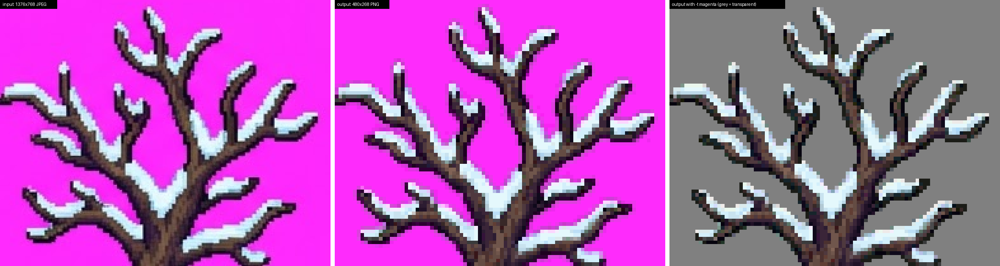

# Repixel

Turn blurry, JPEG-damaged or AI-generated "pixel art" back into real pixel art.

When pixel art is upscaled, compressed or generated by an AI image or video model, one art pixel becomes a fuzzy block of many screen pixels. Usually that's a non-whole number, such as 2.87 × 2.87, and full of JPEG artefacts. Repixel finds the hidden pixel grid by itself and redraws the artwork at its true size, one image pixel per art pixel. It saves the result as a lossless PNG, an animated PNG or a GIF.



## What it does

- **Finds the pixel size automatically**, including fractional sizes like 2.867 px or 22.933 px. If it isn't sure, it asks you (or you can just tell it).
- **Cleans up JPEG noise**: one clean colour per art pixel, and near-identical colours merged into a tidy palette.
- **Removes the background**: make a flat backdrop like magenta transparent and crop to the sprite. It also removes the background colour that JPEG bleeds into the outlines.
- **Handles video**: follows camera zooms frame by frame, keeps every frame aligned on one canvas with one palette, and writes an animated PNG or GIF.
- **Never loses quality**: output is always lossless, and small palettes are saved as compact indexed PNGs.

| Input | Pixel size found | Output |
|---|---|---|
| 1376×768 JPEG of trees | 2.867 px | 480×268 PNG |
| 2752×1536 JPEG sprite sheet | 22.933 px | 120×67 PNG (112×33 trimmed, 1.3 KB) |
| 1280×720 MP4, 10 s | 10.35 → 10.63 px (camera zooms) | 112×34 animated PNG/GIF |


*The soldier sheet, recovered at 112×33 and shown at 6× ([actual size](docs/soldiers_112x33.png)).*


*Recovered from a 10-second AI-generated MP4 at 12 fps, shown at 4×.*

## Install

You need Python 3.10 or newer. For video you also need [ffmpeg](https://ffmpeg.org/).

From the project folder:

```bash
python3 -m venv .venv
.venv/bin/pip install -r requirements.txt
brew install ffmpeg   # only needed for video
```

## Usage

```bash
.venv/bin/python repixel.py my_art.jpg
```

That writes `my_art_repixel.png` next to the input and prints what it found:

```
my_art.jpg: 1376x768  pixel size 2.867 (detected, confidence 0.30)
  -> my_art_repixel.png  480x268, 358 colours, mean reconstruction error 3.8/255
```

### Common recipes

Make a magenta background transparent and crop to the sprites:

```bash
.venv/bin/python repixel.py sheet.jpg -t magenta --trim
```

Let it detect the background colour from the image border:

```bash
.venv/bin/python repixel.py sheet.jpg -t --trim
```

Use your own pixel size when you know it, or when detection guesses wrong:

```bash
.venv/bin/python repixel.py my_art.jpg --scale 2.87
```

Always choose the pixel size yourself from a list of candidates:

```bash
.venv/bin/python repixel.py my_art.jpg --ask
```

Limit the palette to 32 colours:

```bash
.venv/bin/python repixel.py my_art.jpg --colors 32
```

Also save a blown-up copy at the original size, to compare against the input:

```bash
.venv/bin/python repixel.py my_art.jpg --preview
```

Turn a video into a 12 fps sprite animation with a transparent background:

```bash
.venv/bin/python repixel.py walk.mp4 --fps 12 -t --trim
```

Save the animation as a GIF and also write every frame as its own PNG:

```bash
.venv/bin/python repixel.py walk.mp4 --fps 12 -t --trim -o walk.gif --frames walk_frames
```

### Options

| Option | What it does |
|---|---|
| `-o, --output FILE` | Output file. Default: `<input>_repixel.png`. For video, a `.gif` name writes a GIF. |
| `-s, --scale N` | Pixel size to use instead of detecting it (fractions OK). `--scale-y` sets a separate vertical size. |
| `--ask` / `--no-ask` | Always choose the pixel size from a list, or never be asked. |
| `-t, --transparent [COLOUR]` | Make the background transparent. Takes `ff00ff`, `"#ff00ff"`, `0xff00ff`, `"#f0f"`, `magenta`, or nothing to auto-detect. |
| `--key-tol N` | How close to the background colour a pixel must be to be cut (default 100). Raise it if pinkish edge pixels remain. |
| `--no-despill` | Keep the background's tint on edge pixels. By default it's removed, so a purple-tinted outline on magenta goes back to dark. |
| `--trim` | Crop away transparent margins. |
| `--merge N` | Merge colours closer than N (default 18, 0 = off). |
| `--colors N` | Reduce the palette to at most N colours instead. |
| `--no-snap` | Use a perfectly even grid instead of snapping grid lines to edges. |
| `--preview [N]` | Also save an N× upscale (default: back to the input size). |
| `--fps N` | Video: resample to N frames per second first. |
| `--frames DIR` | Video: also save each frame as a PNG. |
| `--dedupe F` | Video: merge consecutive frames that differ in at most fraction F of pixels (default 0.002). |
| `--extent intersect\|union` | Video: keep only the area visible in every frame (default) or in any frame. |
| `--no-deblip` | Video: keep one-frame pixel flickers (removed by default). |

Run `.venv/bin/python repixel.py --help` for the full list.

## Tips

- **Check the numbers it prints.** Confidence above about 0.6 is solid, and around 0.3 is normal for very small pixels. Reconstruction error under about 5/255 means the grid fits the image well; a much larger value usually means the wrong pixel size.
- **If the output looks doubled or smeared**, try one of the alternative sizes it lists with `--scale`, or use `--ask`.
- **For sprite sheets**, generate them on a flat, unusual background colour (magenta works well) and use `-t`.
- **For AI video**, `--fps 8` or `--fps 12` gives a classic sprite feel and skips many motion-blurred in-between frames.
- Put the input file **before** a bare `-t`. In `repixel.py -t sheet.jpg`, the file name would be read as the colour.

## Limitations

- One pixel size per image: a sheet that mixes sprites drawn at different scales will only come out right for the main one.
- Pixel sizes below 2 px can't be detected; pass `--scale`.
- Rotated or perspective-warped grids aren't supported.
- Motion-blurred frames in AI video can keep faint background-coloured smears.

## How it works

Repixel measures where colour jumps between neighbouring rows and columns, and finds the grid size those jumps line up on best, using a frequency analysis that allows fractional sizes. It then lines the grid up with the real edges, takes the median colour from the centre of each cell, and merges noise colours. For video, it repeats this on every frame and places the frames on one shared canvas.

## For AI agents

- [llms.txt](llms.txt): how to use Repixel (commands, output format, settings).
- [AGENTS.md](AGENTS.md): how to work on the code.
