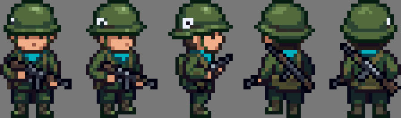
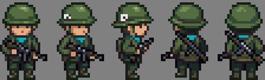
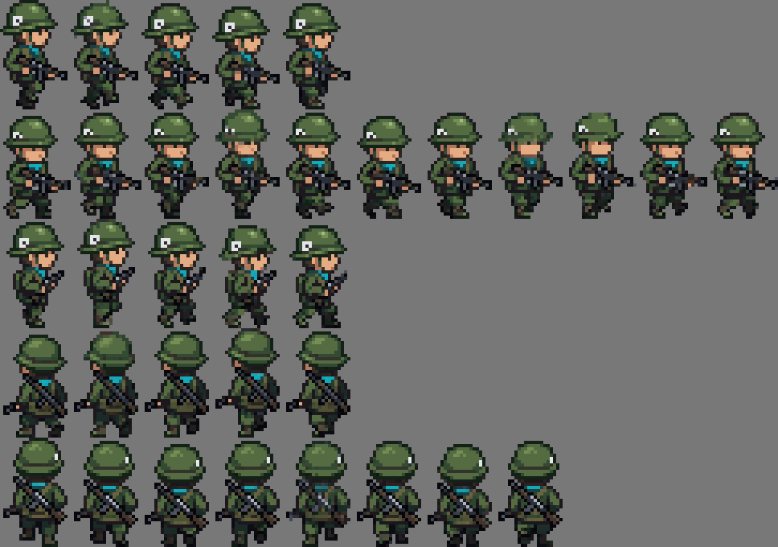
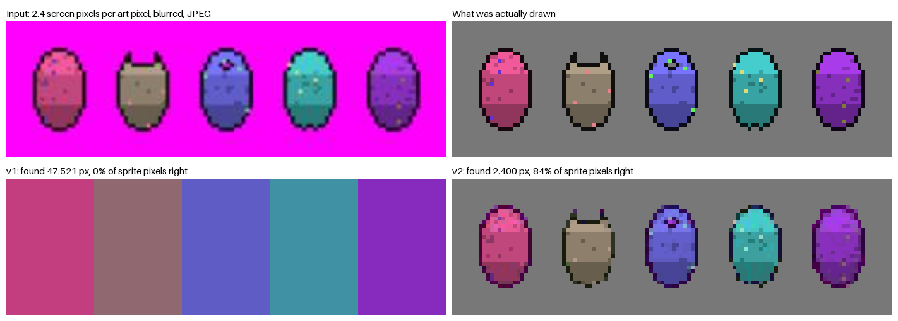

# Repixel

Turn blurry, JPEG-damaged or AI-generated "pixel art" back into real pixel art.

When pixel art is upscaled, compressed or generated by an AI image or video model, one art pixel becomes a fuzzy block of many screen pixels. Usually that's a non-whole number, such as 2.87 × 2.87, and full of JPEG artefacts. Repixel finds the hidden pixel grid by itself and redraws the artwork at its true size, one image pixel per art pixel. It saves the result as a lossless PNG, an animated PNG, a GIF or a sprite sheet.


*Left: the input JPEG. Middle: the 480×268 output. Right: the same with `-t magenta`, on a dark background.*

## What it does

- **Finds the pixel size automatically**, including fractional sizes like 2.867 px or 22.933 px. If it isn't sure, it asks you (or you can just tell it).
- **Cleans up noise without touching clean art**: one colour per art pixel, and colours that differ only by noise merged. A clean, lossless input comes back exactly as drawn.
- **Removes the background**: make a flat backdrop like magenta transparent, everywhere or only where it touches the image border, and crop to the sprite. It also cleans off the background tint that JPEG bleeds into the outlines.
- **Handles video**: follows camera zooms frame by frame, keeps every frame aligned on one canvas with one palette, and turns each pose the video holds for several frames into one clean frame.
- **Makes sprite animations**: separates the sprites, finds the repeating walk cycle, reduces it to the number of frames you want, and writes a sprite sheet.
- **Never loses quality**: output is always lossless, and small palettes are saved as compact indexed PNGs.

| Input | Pixel size found | Output |
|---|---|---|
| 1376×768 JPEG of trees | 2.867 px | 480×268 PNG |
| 2752×1536 JPEG sprite sheet | 22.931 px | 120×67 PNG (112×33 trimmed, 1.5 KB) |
| 1280×720 MP4, 10 s, 240 frames | 10.35 → 10.63 px (camera zooms) | 112×34 animation of 85 poses, or a sprite sheet of walk cycles |



*The soldier sheet, recovered at 112×33 and shown at 6× ([actual size](docs/soldiers_112x33.png)).*



*Recovered from a 10-second AI-generated MP4. The 240 video frames hold only 85 different poses, which Repixel finds by itself. Shown at 4×.*



*The same video with `--split --loop --sheet`: one row per soldier, one walk cycle each.*

## Install

You need Python 3.10 or newer. For video you also need [ffmpeg](https://ffmpeg.org/) (`brew install ffmpeg`, or `apt install ffmpeg` on Linux).

With pip:

```bash
pip install git+https://github.com/happycodelucky/repixel
```

Or with [uv](https://docs.astral.sh/uv/), which keeps it in its own environment:

```bash
uv tool install git+https://github.com/happycodelucky/repixel
```

Either way you get a `repixel` command (`repixel --version` shows which version):

```bash
repixel my_art.jpg
```

To work on the code instead, clone the repository and run it from the project folder. The examples below are written this way; if you installed it, use `repixel` in place of `.venv/bin/python repixel.py`.

```bash
python3 -m venv .venv
.venv/bin/pip install -r requirements.txt
```

## Usage

```bash
.venv/bin/python repixel.py my_art.jpg
```

That writes `my_art_repixel.png` next to the input and prints what it found:

```
my_art.jpg: 1376x768  pixel size 2.867 (detected, confidence 0.30)
  -> my_art_repixel.png  480x268, 365 colours, mean reconstruction error 3.8/255
```

### Common recipes

Make a magenta background transparent and crop to the sprites:

```bash
.venv/bin/python repixel.py sheet.jpg -t magenta --trim
```

Let it detect the background colour from the image border:

```bash
.venv/bin/python repixel.py sheet.jpg -t --trim
```

Remove only the background around the art, keeping the same colour where it appears inside it:

```bash
.venv/bin/python repixel.py sheet.jpg -t --key contiguous
```

Use your own pixel size when you know it, or when detection guesses wrong:

```bash
.venv/bin/python repixel.py my_art.jpg --scale 2.87
```

Always choose the pixel size yourself from a list of candidates:

```bash
.venv/bin/python repixel.py my_art.jpg --ask
```

Limit the palette to 32 colours:

```bash
.venv/bin/python repixel.py my_art.jpg --colors 32
```

Also save a blown-up copy at the original size, to compare against the input:

```bash
.venv/bin/python repixel.py my_art.jpg --preview
```

Turn a video into a sprite animation with a transparent background:

```bash
.venv/bin/python repixel.py walk.mp4 -t --trim
```

Save the animation as a GIF and also write every frame as its own PNG:

```bash
.venv/bin/python repixel.py walk.mp4 -t --trim -o walk.gif --frames walk_frames
```

Make a sprite sheet with one row per character, each showing one walk cycle:

```bash
.venv/bin/python repixel.py walk.mp4 -t --split --loop --sheet -o walk_sheet.png
```

Reduce each walk cycle to exactly 8 frames:

```bash
.venv/bin/python repixel.py walk.mp4 -t --split --loop --poses 8 --sheet -o walk_8.png
```

### Options

| Option | What it does |
|---|---|
| `-o, --output FILE` | Output file. Default: `<input>_repixel.png`. For video, a `.gif` name writes a GIF. |
| `-s, --scale N` | Pixel size to use instead of detecting it (fractions OK). `--scale-y` sets a separate vertical size. |
| `--ask` / `--no-ask` | Always choose the pixel size from a list, or never be asked. |
| `-t, --transparent [COLOUR]` | Make the background transparent. Takes `ff00ff`, `"#ff00ff"`, `0xff00ff`, `"#f0f"`, `magenta`, or nothing to auto-detect. |
| `--key full\|contiguous` | `full` (default) cuts the background colour wherever it appears. `contiguous` cuts only background connected to the image border, so the same colour inside the art stays. |
| `--key-tol N` | How close to the background colour a pixel must be to be cut (default 100). Raise it if pinkish edge pixels remain. |
| `--no-despill` | Leave the background's tint on edge pixels. By default it's cleaned off, so a purple-tinted outline on magenta goes back to dark. |
| `--trim` | Crop away transparent margins. |
| `--merge N` | Merge colours closer than N. Default: chosen from the image's own noise (0 for a clean image, 18 to 30 otherwise). `--merge 0` keeps every colour. |
| `--colors N` | Reduce the palette to at most N colours instead. |
| `--no-snap` | Use a perfectly even grid instead of following drift and snapping lines to edges. |
| `--preview [N]` | Also save an N× upscale (default: back to the input size). |
| `--split` | Video: treat each separate sprite as its own animation, covering only the frames where it moves. Needs `-t`. |
| `--loop` | Video: find the repeating cycle (such as a walk cycle) and keep exactly one. For a walk that is both steps, where the clip shows them cleanly. |
| `--no-repair` | Video, with `--split`, `--loop` or `--poses`: leave ghosted poses as they are. By default the ghost pixels are painted over from their neighbours, and a badly ghosted pose is left out. |
| `--no-vote` | Video, with `--loop`: take the cycle exactly as one pass shows it, without using the other passes to clean it. |
| `--poses N` | Video: reduce the animation to its N most representative frames, avoiding ghosted ones. |
| `--sheet` | Video: write a sprite sheet PNG instead of an animation. One column per frame, and with `--split` one row per sprite. |
| `--fps N` | Video: resample to N frames per second first. |
| `--frames DIR` | Video: also save each output frame as a PNG. |
| `--no-hold` | Video: keep every video frame. By default, poses held for several frames are detected and become one clean frame each. |
| `--dedupe F` | Video: merge consecutive frames that differ in at most fraction F of pixels (default 0.002). |
| `--extent intersect\|union` | Video: keep only the area visible in every frame (default) or in any frame. |
| `--no-deblip` | Video: keep one-frame pixel flickers and blurred in-between pixels (removed by default). |

Run `.venv/bin/python repixel.py --help` for the full list.

## Tips

- **Check the numbers it prints.** Confidence above about 0.6 is solid, and around 0.3 is normal for very small pixels. Reconstruction error under about 5/255 means the grid fits the image well; a much larger value usually means the wrong pixel size.
- **If the output looks doubled or smeared**, try one of the alternative sizes it lists with `--scale`, or use `--ask`.
- **For sprite sheets**, generate them on a flat, unusual background colour (magenta works well) and use `-t`.
- **Check transparent output on a dark and a light background.** If holes appear inside the art because it uses the background colour, add `--key contiguous`.
- **For AI video, leave the frame rate alone at first.** Most of it is animated "on threes": 8 poses a second inside a 24 fps file. Repixel finds those held poses and gives you one clean frame for each, which works better than `--fps`.
- Put the input file **before** a bare `-t`. In `repixel.py -t sheet.jpg`, the file name would be read as the colour.

## Limitations

- One pixel size per image: a sheet that mixes sprites drawn at different scales will only come out right for the main one.
- Pixel sizes below 2 px can't be detected; pass `--scale`.
- Rotated or perspective-warped grids aren't supported.
- Very small pixels (under about 4 px) that are also blurred lose detail that can't be recovered; expect some wrong shades in busy areas.
- AI video sometimes draws a ghost of the previous pose into a frame. Repixel finds these by their odd colours, paints those pixels over and leaves out the worst poses. A ghost made of the sprite's normal colours, such as a doubled outline, is not detected and stays. A short effect with colours of its own (a flash lasting a pose or two) can be mistaken for a ghost; use `--no-repair` if that happens.
- Cleaning a cycle by voting across its repeats only works when the repeats are the same drawing, as in hand-made animation. AI video redraws the character on every pass, so there it rarely applies.
- `--loop` gives one step instead of the full two-step walk cycle when the clip doesn't show two passes that join up cleanly.

## How it works

Repixel measures where colour jumps between neighbouring rows and columns and looks for the grid sizes those jumps line up on, using a frequency analysis that allows fractional sizes. It then redraws the image on each candidate grid and throws out the ones that reproduce it badly, such as the spacing between sprites. It lines the grid up with the real edges, takes the median colour from the centre of each cell, and merges colours that differ only by noise, measuring that noise from the image itself.

For video, it does this on every frame and places the frames on one shared canvas. It then looks at how much the picture changes from frame to frame to find poses that are held, and builds one clean frame per pose by majority vote.

## Progress

Each version is scored on the same benchmark of damaged pixel art with a known answer.

| Version | Right pixel size | Pixels with the right colour | Clean input recovered exactly |
|---|---|---|---|
| v1 | 86% | 78% | no |
| v2 | 100% | 91% | yes |
| v3 | 100% | 91% | yes |

v3 is about video: 4 of the 5 soldiers in the test clip now get a full two-step walk cycle (2 of 5 before), and ghosted poses are repaired or left out.



*One benchmark case: v1 mistook the spacing between sprites for the pixel grid; v2 finds the real 2.4 px grid.*

See [docs/PROGRESS.md](docs/PROGRESS.md) for the full comparison, including background removal and video.

## Checking it works

```bash
.venv/bin/python -m unittest discover tests
```

The tests build pixel art with a known answer, damage it the way upscaling, blur, JPEG and video compression do, and check what Repixel recovers against the original. `tests/bench.py` prints the full accuracy table.

## For AI agents

- [llms.txt](llms.txt): how to use Repixel (commands, output format, settings).
- [AGENTS.md](AGENTS.md): how to work on the code.
