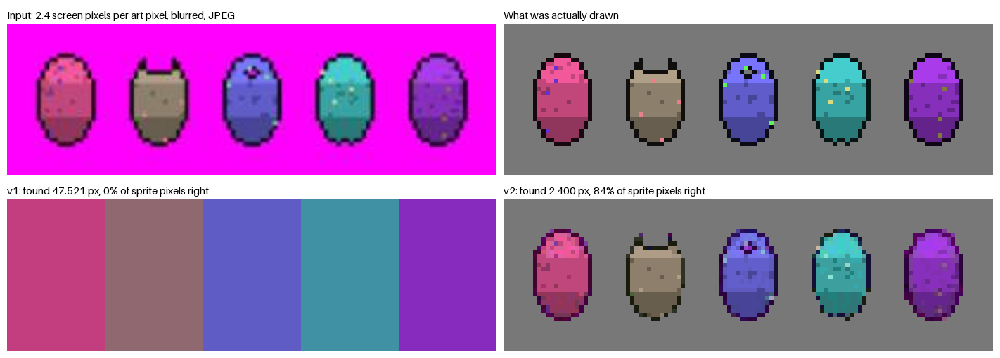

# Progress

How Repixel's results have changed from version to version.

Every version is measured the same way. `tests/bench.py` takes pixel art with a known answer, damages it the way upscaling, blur, JPEG and uneven grids do, runs the tool, and scores the result against the original (186 cases). The pictures on this page come from `docs/make_progress.py`, which pulls each earlier version out of git history and runs it on the same inputs as the current code.

## Benchmark by version

| Version | Commit | Right pixel size | Pixels with the right colour | Clean input recovered exactly | 240-frame test video |
|---|---|---|---|---|---|
| v1 | `d6fec30` | 86% | 78% | no (92%) | 15.7 s, 239 frames out |
| v2 | `e3e68ed` | 100% | 91% | yes (100%) | 6.5 s, 85 poses out |

Pixels with the right colour, by kind of damage:

| Damage | v1 | v2 |
|---|---|---|
| None (lossless upscale) | 92% | 100% |
| JPEG quality 90 | 88% | 93% |
| Blur + JPEG quality 75 | 75% | 88% |
| Off-centre grid + blur + noise + JPEG 70 | 59% | 85% |
| Uneven (drifting) grid + blur + JPEG 80 | 70% | 88% |
| Soft edges + JPEG 85 | 84% | 91% |

## v2

Detection, colour cleanup, background removal and video handling were reworked against the benchmark.

### Finding the pixel size

v1 scored candidate grid sizes only by how well edges lined up on them. On a sheet of evenly spaced sprites with small, blurred pixels, the spacing between sprites lines up better than the pixels do, so v1 picked that. v2 also redraws the image on each candidate grid and throws out the ones that reproduce it badly.

*A benchmark case with a known answer. v1 mistook the sprite spacing for the pixel grid and returned five flat blocks. v2 finds the 2.4 px grid. Its outlines still carry some of the background's tint: at this size, blur and JPEG leave little to work with.*

### Background removal

v1 removed all of the background's hue from edge pixels. Pixels that were half background turned light grey instead of being cut, which shows as specks on a dark background. v2 compares each edge pixel's tint with the art around it, gives it a nearby clean colour, or cuts it if it is mostly background.

*The real trees image with `-t magenta`, on a dark background. v1 leaves light specks along the outline of the leaves.*

v2 also adds `--key contiguous`, which removes only background connected to the image border, for art that uses the background colour itself.

### Video

AI video is usually animated "on threes": about 8 poses a second inside a 24 fps file. v1 wrote out every video frame, so each pose appeared two to four times with compression flicker between the copies. v2 finds the held poses and builds one clean frame for each.

*Twelve output frames in a row from the point where the first soldier starts walking. v1's twelve frames hold four poses; v2's hold twelve.*

v2 also adds `--split`, `--loop`, `--poses N` and `--sheet`, which separate the sprites, find each walk cycle, reduce it to a set number of frames, and write a sprite sheet.

### Also in v2

- A clean, lossless upscale now comes back exactly, with the same palette. The colour merge distance is measured from the image's own noise instead of being fixed.
- Images with an alpha channel keep it.
- The video path is about 2.4× faster.
- A test suite (30 tests) and the benchmark itself.

## Since v2

- `--loop` now uses the other passes of the cycle to clean the one it keeps. Where the passes are the same drawing, each pixel takes the majority value; otherwise a ghosted pose is swapped for a cleaner pass of the same pose. On hand-made style animation with exact repeats this removes random errors. On the AI test clip it does little, because the model redraws the soldier on every pass (the same pose shares only 30–80% of its pixels between passes): one pose is swapped and none are voted.
- `--poses` now prefers the least ghosted frame among the near-equally typical ones.

## v1

The first version: grid detection from edge profiles with fractional pixel sizes, centre-median sampling, a fixed colour merge distance, background keying with despill, and frame-by-frame video with a shared canvas and palette.
