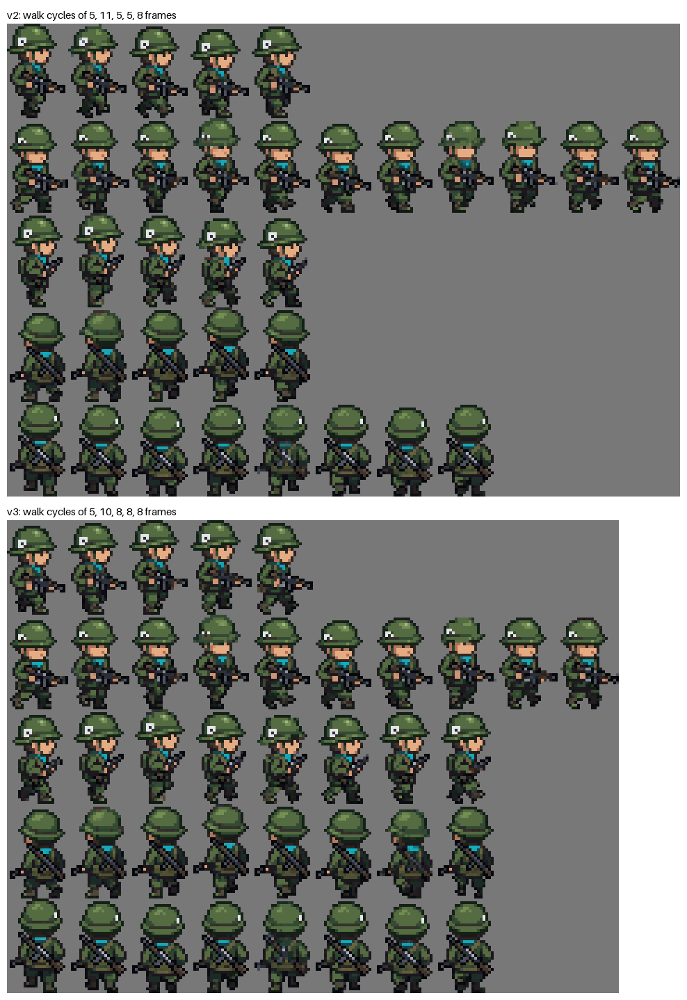
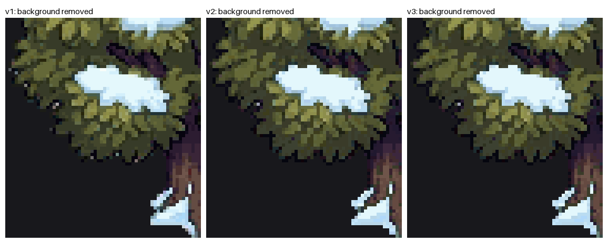
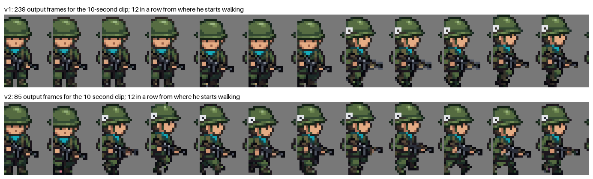

# Progress

How Repixel's results have changed from version to version.

Every version is measured the same way. `tests/bench.py` takes pixel art with a known answer, damages it the way upscaling, blur, JPEG and uneven grids do, runs the tool, and scores the result against the original (186 cases). The pictures on this page come from `docs/make_progress.py`, which pulls each earlier version out of git history and runs it on the same inputs as the current code.

## Benchmark by version

| Version | Commit | Right pixel size | Pixels with the right colour | Clean input recovered exactly | 240-frame test video |
|---|---|---|---|---|---|
| v1 | `d6fec30` | 86% | 78% | no (92%) | 15.7 s, 239 frames out |
| v2 | `e3e68ed` | 100% | 91% | yes (100%) | 6.5 s, 85 poses out |
| v3 | this version | 100% | 91% | yes (100%) | 6.5 s, 85 poses out |

Walk cycles found in the test video (five soldiers, `--split --loop`):

| Version | Soldiers given a full two-step cycle | Ghosted poses in the cycles |
|---|---|---|
| v2 | 2 of 5 (the others got a single step) | left as they were |
| v3 | 4 of 5 | 7 repaired, 2 of those left out as too far gone |

Pixels with the right colour, by kind of damage:

| Damage | v1 | v2 |
|---|---|---|
| None (lossless upscale) | 92% | 100% |
| JPEG quality 90 | 88% | 93% |
| Blur + JPEG quality 75 | 75% | 88% |
| Off-centre grid + blur + noise + JPEG 70 | 59% | 85% |
| Uneven (drifting) grid + blur + JPEG 80 | 70% | 88% |
| Soft edges + JPEG 85 | 84% | 91% |

## v3

Still images are unchanged. This version is about getting clean, complete loops out of video.

*`--split --loop --sheet` on the test clip. v2 gives three of the soldiers a single step; v3 gives four of them the full two-step cycle and cleans or leaves out the ghosted poses.*

- **Full cycles.** A walk repeats after two steps, but one step looks much like the other, so v2 often stopped at one. v3 measures the rhythm in real time (poses are held for 2 to 6 frames in this clip, which distorted it), compares only the moments when something moves, and takes the two-step cycle when it joins up as well as the single step does. One soldier still gets a single step: the clip does not contain two clean passes of his walk.
- **Ghosted poses.** Video models leave a faint copy of the previous pose in some frames. v3 finds these by their colours: a sprite keeps its palette as it moves, and a ghost is a mixture, which is a colour of its own that appears in that pose and nowhere else. In a pose with many such pixels they are painted over from their neighbours, and a badly ghosted pose is left out of the animation. The between-colours test used in v2 found none of the poses that are visibly ghosted.
- **Voting across cycles.** Where at least two other passes of a cycle show the same drawing, each pixel takes the majority value. This helps hand-made style animation with exact repeats. On the AI test clip it never applies, because the model redraws the soldier on every pass (the same pose shares only 30–80% of its pixels between passes).
- **Installing.** `pip install` and `uv tool install` now work, and give a `repixel` command.

Ghosts made of the sprite's normal colours (a doubled helmet outline, say) are not detected and remain.

### 0.3.1: code review fixes

A review of the whole tool found ten defects, each now fixed and covered by a test that fails on the old code:

- `-t` on an image that already has transparency failed outright.
- Ghost repair ran on every video and could paint over anything that was only on screen briefly. It now runs only for sprite animations (`--split`, `--loop`, `--poses`).
- A clean, lossless clip did not come back exact, because edge clean-up ran regardless. Video now follows the same rule as still images.
- `--merge` on a clean image switched edge clean-up back on.
- Dropping a ghosted first frame of a non-looping animation moved its time to the end.
- `--split` reported nothing left when a sprite travelled across the canvas.
- GIF export failed with exactly 256 colours and no transparency.
- A file that is not really a video produced a Python traceback instead of an error message.
- Videos with a rotation tag were decoded with their sides swapped.
- Video kept every frame in memory at about eight times the size needed.

The test suite also now runs on Linux and macOS on every push.

## v2

Detection, colour cleanup, background removal and video handling were reworked against the benchmark.

### Finding the pixel size

v1 scored candidate grid sizes only by how well edges lined up on them. On a sheet of evenly spaced sprites with small, blurred pixels, the spacing between sprites lines up better than the pixels do, so v1 picked that. v2 also redraws the image on each candidate grid and throws out the ones that reproduce it badly.

*A benchmark case with a known answer. v1 mistook the sprite spacing for the pixel grid and returned five flat blocks. v2 finds the 2.4 px grid. Its outlines still carry some of the background's tint: at this size, blur and JPEG leave little to work with.*

### Background removal

v1 removed all of the background's hue from edge pixels. Pixels that were half background turned light grey instead of being cut, which shows as specks on a dark background. v2 compares each edge pixel's tint with the art around it, gives it a nearby clean colour, or cuts it if it is mostly background.

*The real trees image with `-t magenta`, on a dark background. v1 leaves light specks along the outline of the leaves.*

v2 also adds `--key contiguous`, which removes only background connected to the image border, for art that uses the background colour itself.

### Video

AI video is usually animated "on threes": about 8 poses a second inside a 24 fps file. v1 wrote out every video frame, so each pose appeared two to four times with compression flicker between the copies. v2 finds the held poses and builds one clean frame for each.

*Twelve output frames in a row from the point where the first soldier starts walking. v1's twelve frames hold four poses; v2's hold twelve.*

v2 also adds `--split`, `--loop`, `--poses N` and `--sheet`, which separate the sprites, find each walk cycle, reduce it to a set number of frames, and write a sprite sheet.

### Also in v2

- A clean, lossless upscale now comes back exactly, with the same palette. The colour merge distance is measured from the image's own noise instead of being fixed.
- Images with an alpha channel keep it.
- The video path is about 2.4× faster.
- A test suite (30 tests) and the benchmark itself.

## v1

The first version: grid detection from edge profiles with fractional pixel sizes, centre-median sampling, a fixed colour merge distance, background keying with despill, and frame-by-frame video with a shared canvas and palette.
